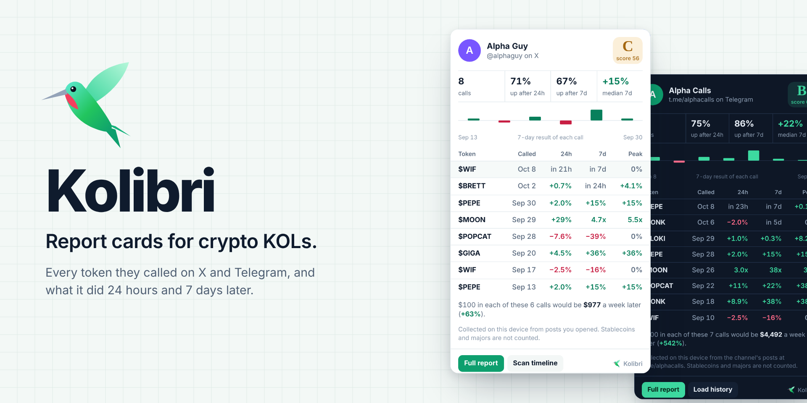
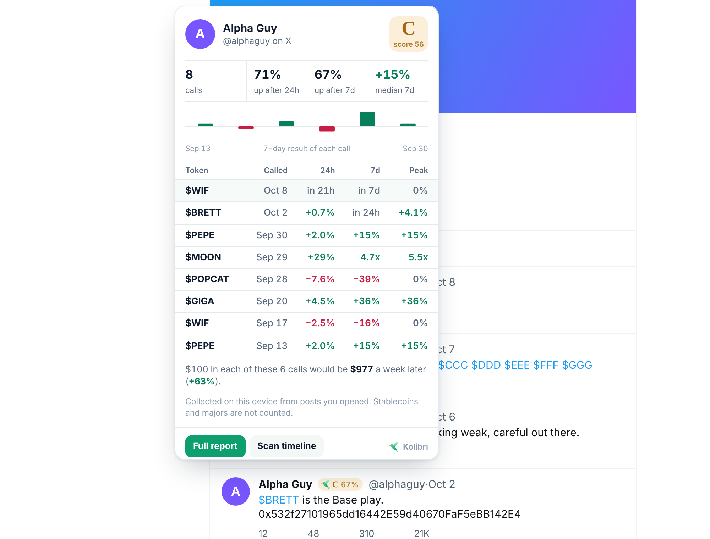
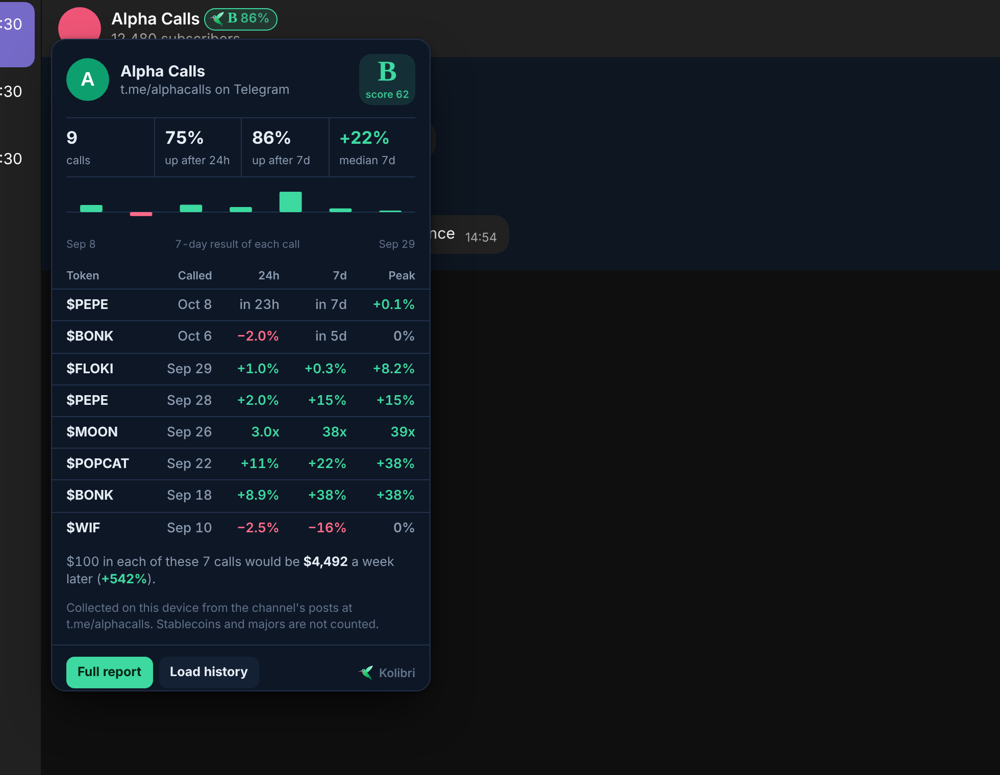
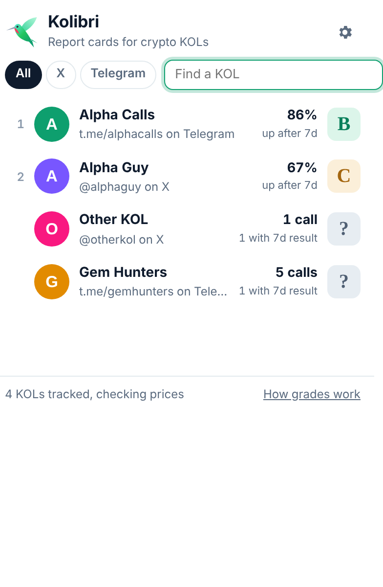
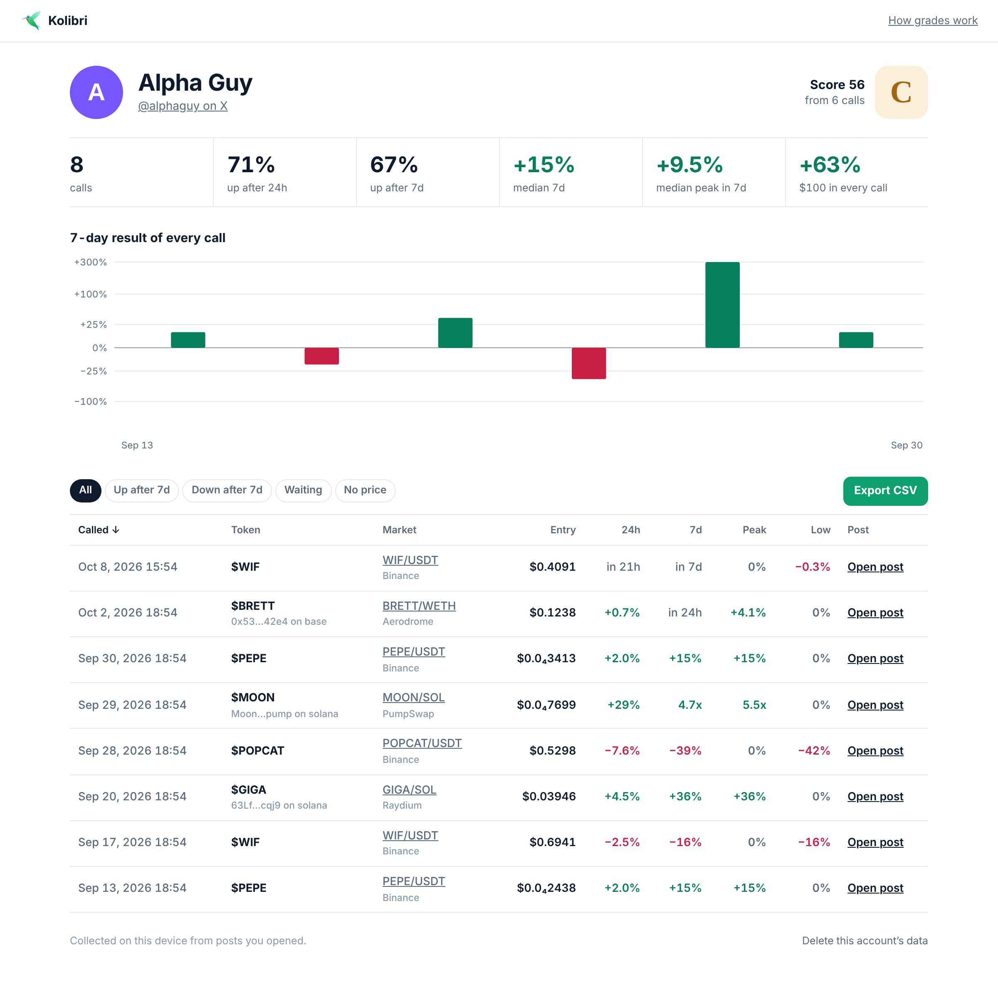
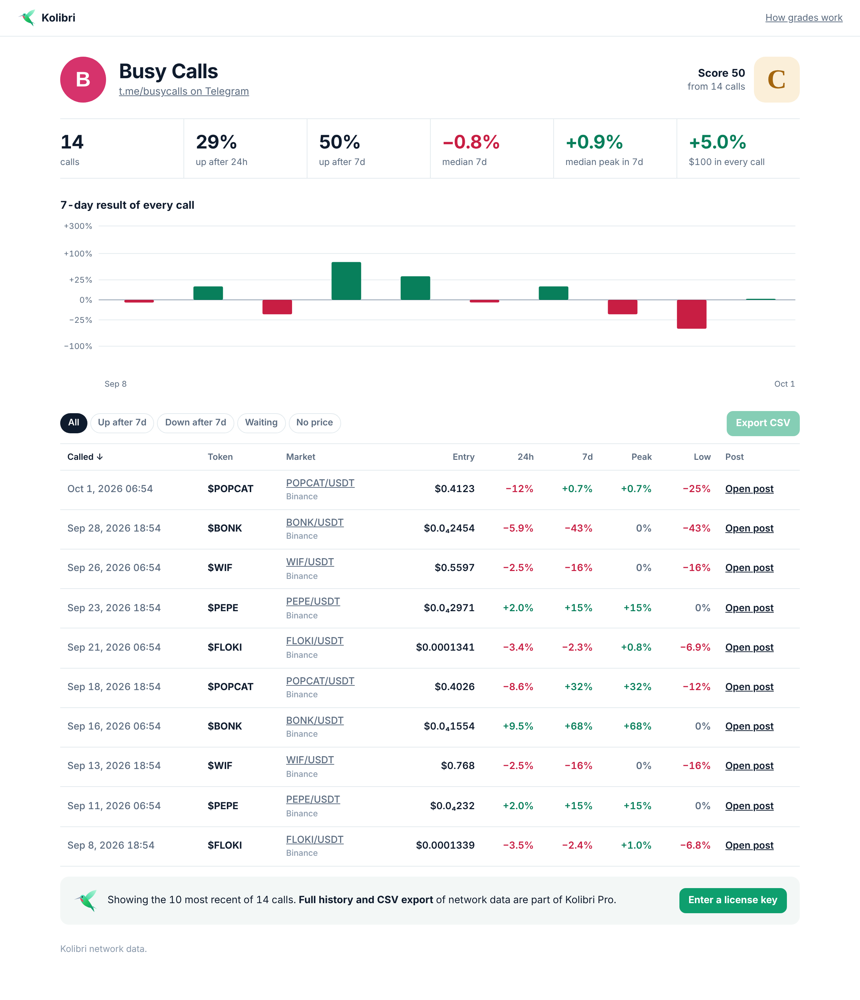
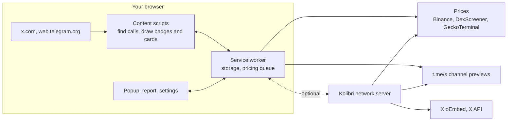

<p align="center"></p>

# Kolibri

**Kolibri** is a browser extension that puts a report card next to every crypto KOL on X and every channel in Telegram Web: which tokens they called, and what those tokens did **24 hours** and **7 days** later.

Hover the hummingbird next to a name and you see the receipts — win rate, median return, every call with its entry price, and what $100 in each call would have become a week later. No more taking "called it at 10k mcap" on faith.

> *Kolibri* is "hummingbird" in Russian and German, and it starts with **KOL**. Hummingbirds hover; so does the report card.

| On X | In Telegram Web |
| --- | --- |
|  |  |

<sub>Screenshots come from the end-to-end test: look-alike X and Telegram pages with simulated prices.</sub>

## What it does

- **A grade next to every caller.** A small badge appears beside author names on X (timeline, profiles, hover cards, people lists) and beside channel titles in Telegram Web (both `/k/` and `/a/`). The letter is the grade; the number is the share of calls that were up 7 days later.
- **The report card.** Hover the badge: calls, share up after 24h and after 7d, median 7-day return, a bar for every call, and the latest calls with their 24h, 7d and peak results.
- **Full report.** Every call with entry price, market used, 24h / 7d / peak / drawdown, links to the post and the chart, filters, sorting and CSV export.
- **Leaderboard.** The toolbar popup ranks everyone Kolibri has seen, best grades first.
- **History without waiting.** On an X profile, *Scan timeline* reads their recent posts. For a public Telegram channel, Kolibri reads its history from the public `t.me/s/` preview automatically — no Telegram login involved.
- **Works on its own.** Everything runs in your browser. An optional [Kolibri network server](#the-kolibri-network-server) adds history collected around the clock, a public leaderboard, and paid Pro access.

## Install

Kolibri runs in Chrome, Edge, Brave, Arc, Opera and other Chromium browsers (version 116+).

1. Download this repository (Code → Download ZIP) and unzip it, or `git clone` it. A packed build is also attached to each [release](../../releases).
2. Open `chrome://extensions`, turn on **Developer mode**.
3. Click **Load unpacked** and choose the `extension` folder.
4. Open [x.com](https://x.com) or [web.telegram.org](https://web.telegram.org) and read as usual.

Pin the hummingbird in the toolbar to reach the leaderboard.

| Leaderboard | Full report |
| --- | --- |
|  |  |

## How report cards work

| | |
| --- | --- |
| **A call** | The first time an account posts a token's `$TICKER` or contract address. Mentions of the same token within 7 days are the same call; after that it is a new call. Posts listing more than six tokens are treated as commentary. Stablecoins, fiat and stock tickers are ignored, and so are majors (BTC, ETH, SOL…) unless you turn them on. |
| **Entry price** | The price within 15 minutes after the post: the close of the 15-minute candle containing it. Tweet times come from the tweet id itself, so they are exact. |
| **24h, 7d, peak** | The price 24 hours and 7 days after the post, and the best 15-minute close within those 7 days. Tokens that launched on a bonding curve (pump.fun and friends) are followed into the pool they migrated to. |
| **Prices** | Binance spot for listed tickers (full history). DEX tokens: DexScreener finds the chain and pools, GeckoTerminal provides the candles. A ticker without an address is matched to its most liquid token; the market used is always shown. |
| **Grade** | Score 0–100 = 60% share of calls up after 7 days (Laplace-smoothed) + 40% median 7-day return (capped at ±100%), pulled toward 50 while the sample is small. **A** ≥ 75, **B** ≥ 62, **C** ≥ 50, **D** ≥ 38, **F** below. Shown once 3 calls have a 7-day result. |
| **$100 in each call** | What putting the same amount into every call and selling a week later would have returned (the mean 7-day return). |

The exact code is in [`extension/shared`](extension/shared): [`extract.js`](extension/shared/extract.js) finds calls, [`prices.js`](extension/shared/prices.js) measures them, [`score.js`](extension/shared/score.js) grades them.

**Known limits.** Keyless GeckoTerminal serves about 10 requests a minute and six months of candles, so a long DEX history takes a few minutes to price and older DEX calls show *n/a* (a free CoinGecko Demo key in Settings raises the rate). X shortens links to `t.co`, so a call made only through a chart link (no ticker or address in the text) can be missed by the extension; the server's X API collector sees expanded links. A mention counts as a call whether it was bullish or not — the post is one click away in the report.

## Free and Pro

| | Free | Pro |
| --- | --- | --- |
| Everything Kolibri collects in your browser | ✓ full history and CSV | ✓ |
| Kolibri network: grades and public leaderboard | ✓ | ✓ |
| Kolibri network: calls per account | 10 most recent | full history |
| Kolibri network: CSV export | — | ✓ |



Pro is unlocked with a license key that the server verifies (`Settings → Kolibri network → Pro license key`). Payments are not part of this repository: issue keys from your checkout (Stripe, Lemon Squeezy, crypto) through the server's admin endpoint. To gate local data as well, set `GATE_LOCAL_DATA: true` in [`extension/shared/config.js`](extension/shared/config.js).

## Architecture



The content scripts never fetch anything: they read the page, extract calls and send them to the service worker, which owns storage and does all network requests with per-host rate limits. Pricing survives browser restarts (state in `chrome.storage`, an alarm resumes the queue) and re-checks each call when its 24-hour and 7-day marks pass.

## The Kolibri network server

[`server/`](server) is a dependency-free Node.js service (built-in `node:sqlite` and `http`) that shares the extension's extraction, pricing and scoring code. It:

- collects public Telegram channels from `t.me/s/` on a schedule;
- accepts post links from extension users who opt in, re-reads each one through X's public oEmbed endpoint and credits it to the author X reports;
- optionally pulls timelines through the X API (`X_BEARER_TOKEN`), which also gives it the expanded links;
- prices every call, serves report cards, the leaderboard (JSON and a public web page), license checks and Pro CSV export.

```bash
node server/src/index.js          # Node 22.13+, no npm install needed
# or
docker build -t kolibri-server . && docker run -p 8787:8787 -v kolibri-data:/app/server/data kolibri-server
```

Then in the extension: **Settings → Kolibri network → Server URL**. Configuration and the API are documented in [server/README.md](server/README.md).

## Privacy and permissions

Kolibri reads the X and Telegram Web pages you open and keeps what it finds in `chrome.storage` in your browser. It sends nothing anywhere unless you connect a Kolibri server (and post links only if you also turn on sharing).

| Permission | Why |
| --- | --- |
| `storage`, `unlimitedStorage` | Calls, prices and report cards live in your browser. |
| `alarms` | Resume pricing and re-check calls when their 24h / 7d marks pass. |
| `data-api.binance.vision`, `api.dexscreener.com`, `api.geckoterminal.com`, `api.coingecko.com` | Prices. |
| `t.me` | Public channel history. |
| Content scripts on `x.com`, `twitter.com`, `web.telegram.org` | Read posts and draw badges. |
| Optional host access | Asked for only when you connect a Kolibri server. |

## Development

```
extension/          the browser extension (Manifest V3, no build step)
  shared/           pure logic, also used by the server and tests
  background/       service worker: storage, pricing queue, t.me history, network API client
  content/          X and Telegram Web integrations, badge and card UI
  popup/ options/ report/ pages/
server/             Kolibri network server (Node 22.13+, zero dependencies)
test/               unit tests, server tests, end-to-end test with mock pages
scripts/            icons, banner and release packaging
docs/               banner and screenshots
```

```bash
npm test                     # unit + server tests (node:test), no install needed
npm install                  # dev tools: playwright, sharp
npx playwright install chromium
npm run test:e2e             # loads the extension in Chromium against mock X / Telegram / market pages
SHOTS=1 npm run test:e2e     # also refreshes docs/screenshots
node scripts/render-banner.js
npm run icons                # extension/icons/*.png from icon.svg
npm run pack                 # dist/kolibri-<version>.zip for the Chrome Web Store
```

The end-to-end test serves look-alike X and Telegram Web pages plus a simulated market (Binance, DexScreener, GeckoTerminal, t.me) and checks the whole loop: collection, pricing (including a bonding-curve migration), grades, badges, cards, pages, and the network mode against a real local server. The screenshots in this README come from that run. X and Telegram change their markup from time to time; every selector Kolibri relies on is kept at the top of [`content/x.js`](extension/content/x.js) and in the adapters in [`content/telegram.js`](extension/content/telegram.js).

## Roadmap

- Sentiment: tell "buying $X" from "$X is a scam" before counting a call.
- Benchmarks: show each call against BTC over the same week.
- Firefox build (background scripts instead of a service worker).
- Expand `t.co` links in the extension to catch chart-link-only calls.
- Checkout integration for Pro keys.

## License

[MIT](LICENSE)
